# Search-POGEMA

**Decentralized multi-agent search for hidden targets on top of [POGEMA](https://github.com/Cognitive-AI-Systems/pogema).**
Swarm rules vs frontier exploration vs a learned IPPO policy, under partial observability, limited
communication and agent failures.

[Русская версия](README_ru.md) · [Report (PDF, 5 pages)](report/report.pdf)

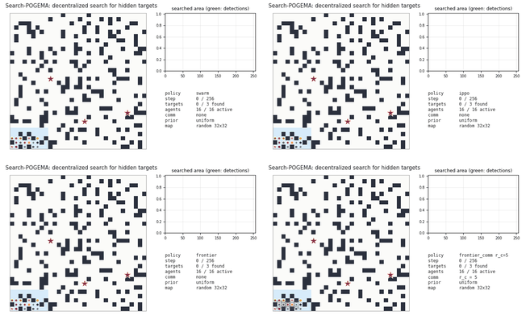

*The same episode for four methods: 32×32 map, 16 agents deployed from one base, 3 hidden targets
(red = hidden, green = found), 25% of the agents fail during the search (grey ×). Blue = searched area,
darker = searched later. A single episode, for illustration only; statistics are below.*

---

## Contents

1. [Motivation](#motivation)
2. [Task](#task)
3. [Metrics](#metrics)
4. [Methods](#methods)
5. [Experiments](#experiments)
6. [Results](#results)
7. [GIF gallery](#gif-gallery)
8. [Things that went wrong and what I learned](#things-that-went-wrong-and-what-i-learned)
9. [Limitations and next steps](#limitations-and-next-steps)
10. [Reproduce](#reproduce)
11. [Repository layout](#repository-layout)

---

## Motivation

POGEMA is a fast grid benchmark for decentralized multi-agent pathfinding: every agent knows its goal
and has to reach it without collisions while seeing only a small window around itself. Many real
multi-robot problems are different: the goal is **unknown**. Search and rescue, inspection, finding
lost objects. The team has to spread out, cover the area, avoid searching the same place twice and
keep working when communication is poor and some robots break down.

The question of this project:

> How do local swarm rules compare with classic frontier exploration and a learned MARL policy when
> searching for hidden targets with partial observability, limited communication and agent loss?

To answer it I kept everything that POGEMA does well (maps, movement, collisions, egocentric view,
speed) and added the missing parts of a search task.

## Task

| element | definition |
|---|---|
| maps | POGEMA random maps (obstacle density 0–0.3), mazes and warehouses from `pogema-toolbox` |
| motion | POGEMA dynamics: 5 actions (stay, up, down, left, right), `priority` collisions |
| agents | N agents start clustered around a random base (deployment from one point) |
| targets | K hidden targets in the agents' connected component, never visible at t = 0; uniform, or drawn from a Gaussian prior whose centre and width the agents know |
| sensing | POGEMA window, `obs_radius = 3`; a target is detected when an active agent is within Chebyshev distance `detect_radius = 2` |
| memory | each agent keeps seen cells, known obstacles, searched cells and its visit counts |
| communication | agents within Euclidean distance `r_c` merge their memories, one hop per step; `r_c = 0` none, `r_c = ∞` global |
| failures | a fraction p of agents stops moving, sensing and communicating at a random step `~U[1, 0.5·size]`; a broken robot keeps blocking its cell |
| episode end | all targets found, or `T = 8·size` steps |

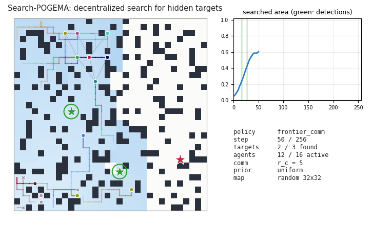

How it sits on top of POGEMA (`pogema_search/env.py`): POGEMA's `PogemaCoopFinish` with
`on_target='nothing'` provides movement and observations (the default `'finish'` would remove an
agent at its own POGEMA goal). Failures use `grid.is_active`, so POGEMA itself stops moving the agent.
A new `GridConfig` is built every episode because `reset(seed=...)` does not change the map.

## Metrics

* **success**: all targets found within T;
* **t_first, t_last**: steps to the first and to the last detection, reported as a fraction of T;
  an unsolved episode counts as T;
* **coverage curve** (searched share of the reachable area over time) and its AUC;
* **revisit ratio** = 1 − distinct visited cells / agent-steps;
* **communication volume**: messages and transmitted cells;
* **robustness** = metric(p) / metric(0) on the same seeds.

Every number is a mean with a 95% percentile-bootstrap CI. All methods are run on the **same seeds**,
so they see identical maps, starts, targets and failure times (paired comparison).

## Methods

| method | idea | uses |
|---|---|---|
| `random_walk` | random move among free neighbours | local view |
| `levy` | Lévy walk: straight flights of length L with P(L) ∝ L^−μ, μ = 2 | local view |
| `frontier` | nearest frontier (Yamauchi): BFS over the own map to the closest known free cell that is unsearched or borders unknown space | own map |
| `frontier_comm` | the same with maps merged within r_c | own + received maps |
| `frontier_coord` | + goal sharing: agents send their goal, a frontier near a goal of a higher-priority neighbour is penalised (decentralized version of Burgard et al. 2005) | maps + neighbours' goals |
| `swarm` | local rule, see below | own memory, local view, prior |
| `ippo` | one shared CNN actor-critic trained with independent PPO | own memory, local view, prior |

**Swarm rule** (`policies/swarm.py`). Each step the agent picks the free neighbour cell with the
best score:

```
score = w_gain · new cells in the detection footprint
      − w_visit · own visit count
      − w_rep · Σ max(0, 1 − d / R) over visible agents        (dispersion)
      + w_pull · cos(move, direction to unsearched prior mass)  (stronger when nothing new is around)
      + w_mom · [same move as before] + small noise
```

The pull direction is Σ p(c)·e^(−d/λ)·(c − x)/d² over unsearched cells. My first version pulled
towards the centroid of the unsearched area and failed badly: the centroid often lies inside an
already searched hole and the agent circles around it (a single agent covered 16% of the map instead
of 74%).

**IPPO** (`rl/`). Input of an agent: a 15×15 crop of its own memory (7 channels: known obstacles,
unknown, searched, visible agents, visits, prior, outside of the map), the whole map pooled to 8×8
(so the same network works on 16, 32 and 64 maps), t/T and the share of found targets. Invalid moves
are masked. Reward: +1 per detected target, +0.02 per prior-weighted cell the agent searched first in
the team. Curriculum 16×16 → 32×32 over random densities, numbers of targets, priors, failures and
r_c ∈ {0, 5}. 2.47M agent-steps, about 45 minutes on two CPU cores.

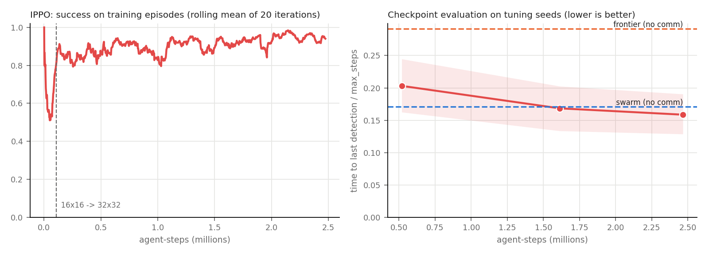

Seeds are split into three disjoint ranges: training 10⁶+, tuning 10⁴+, evaluation 0–19. The swarm
weights, the Lévy exponent, the allocation parameters, the IPPO checkpoint and its action selection
(sampling; greedy argmax gets stuck in loops) were chosen on tuning seeds only.

## Experiments

* **Full grid**, uniform targets, random maps: size {16, 32, 64} × density {0, 0.1, 0.2, 0.3} ×
  agents {4, 8, 16, 32, 64} × targets {1, 3} × failures {0, 0.25, 0.5}; r_c ∈ {2, 5, ∞} for the
  communicating frontier variants and {0, ∞} for IPPO. 10 seeds per cell, **43 200 episodes**.
* **Prior slice**: Gaussian target prior, sizes 32/64, density 0.1/0.2, 8/16/32 agents, p ∈ {0, 0.5}.
* **Maps slice**: mazes and warehouses, sizes 32/64, 8/16/32 agents, p ∈ {0, 0.5}.

## Results

### Overall

Full grid, pooled over all 360 configurations (3 600 episodes per method):

| method | success | t_last / T | revisit | messages / episode |
|---|---|---|---|---|
| random walk | 0.461 [0.444, 0.477] | 0.716 [0.704, 0.727] | 0.825 | 0 |
| Lévy walk | 0.740 [0.725, 0.754] | 0.501 [0.489, 0.514] | 0.692 | 0 |
| frontier | 0.868 [0.857, 0.878] | 0.409 [0.399, 0.420] | 0.675 | 0 |
| **swarm rule** | 0.900 [0.890, 0.909] | **0.259** [0.249, 0.269] | 0.463 | 0 |
| **IPPO** | 0.914 [0.905, 0.922] | **0.259** [0.250, 0.269] | 0.470 | 0 |
| frontier + maps, r_c = 2 | 0.951 [0.944, 0.958] | 0.242 [0.234, 0.250] | 0.481 | 1 619 |
| frontier + maps, r_c = 5 | 0.975 [0.969, 0.980] | 0.194 [0.187, 0.201] | 0.430 | 6 026 |
| frontier + maps, global | 0.985 [0.981, 0.989] | 0.178 [0.172, 0.184] | 0.412 | 25 483 |
| frontier + allocation, r_c = 5 | 0.976 [0.972, 0.981] | 0.200 [0.194, 0.207] | 0.456 | 7 459 |
| frontier + allocation, global | 0.989 [0.986, 0.992] | **0.173** [0.168, 0.178] | 0.424 | 28 753 |
| IPPO, global maps (not trained on it) | 0.934 [0.925, 0.942] | 0.223 [0.214, 0.232] | 0.428 | 29 011 |

### 1. Without communication the swarm rule and IPPO are tied, both far ahead of frontier

Both are 1.5–2.2× faster than frontier exploration without communication (depending on map size).
Frontier without a shared map sends neighbouring agents to the same nearest frontiers (revisit ratio
0.68 vs 0.46). Cell by cell, with a paired test:

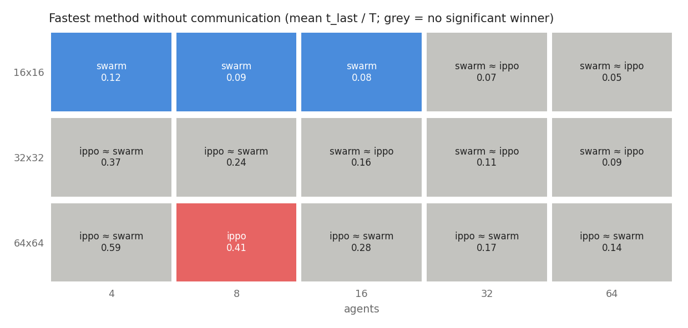

*Grey cells: the paired 95% CI of the difference between the two best methods contains zero.*

The swarm rule is significantly better on 16×16 with 4–16 agents, IPPO only on 64×64 with 8 agents;
everywhere else it is a tie. IPPO gets relatively better on larger maps (t_last/T, swarm vs IPPO:
0.083 vs 0.105 on 16×16, 0.195 vs 0.198 on 32×32, 0.359 vs 0.319 on 64×64), although it never saw a
64×64 map during training.

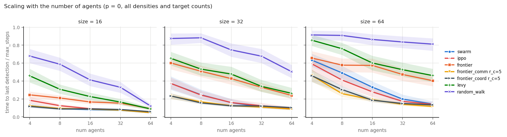

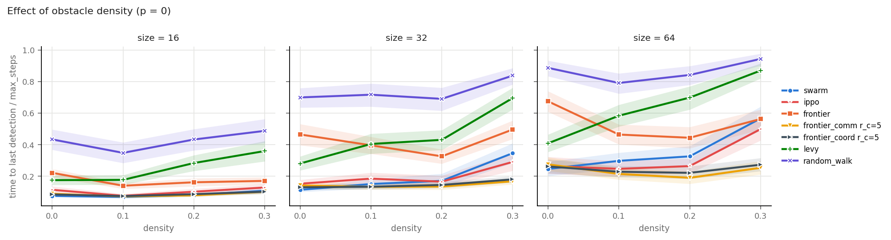

On empty 64×64 maps frontier without communication is even worse than on maps with obstacles (0.68 vs
0.44 of T): with no walls to separate them, the agents starting from one base keep choosing the same
frontiers.

### 2. Communication is the strongest single factor

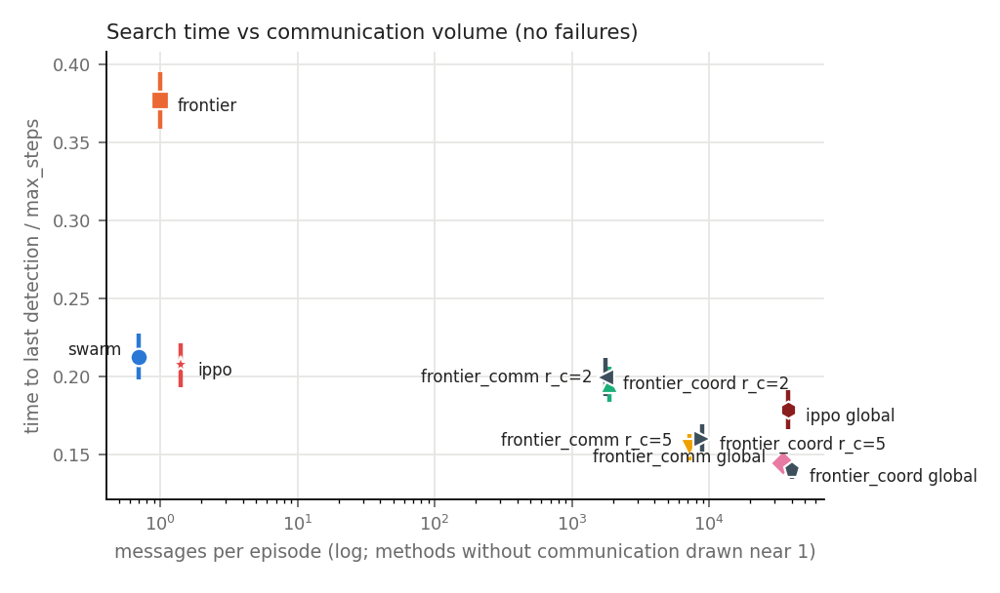

* r_c = 5 gives most of the gain of global map sharing (0.154 vs 0.144 of T without failures) with
  about 21% of its messages.
* r_c = 2 is only a little faster than the swarm rule without any messages (0.195 vs 0.213) and
  sends about 1 900 messages per episode.
* IPPO profits from shared maps without retraining (0.207 → 0.178), because its input is its own
  memory, which the environment merges. It gains less than frontier, whose planner uses the map
  explicitly.
* **Goal allocation is not a free win.** With global communication it is the fastest method
  (paired difference to frontier + maps −0.005 [−0.008, −0.001]), mostly on 64×64 (−0.016), and
  slightly worse on 16×16. With r_c = 5 it is slightly worse overall (+0.006 [+0.003, +0.010]): an
  agent only sees the claims of its closest neighbours, and the penalty sends it to more distant
  frontiers without a global picture.

### 3. Agent loss

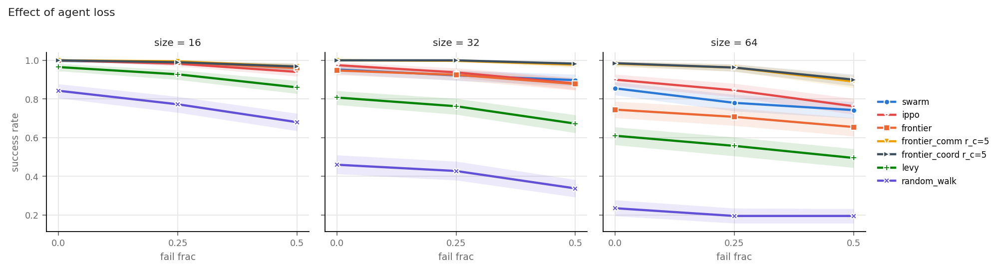

Losing half of the agents makes the search 1.44× longer for the swarm rule, 1.54× for IPPO and 1.60×
for frontier with r_c = 5. Relative numbers favour slow methods (random walk only ×1.12, it is near
the limit anyway), so absolute success matters more: on 64×64 with 50% loss success is 0.74 (swarm),
0.76 (IPPO) and 0.89 (frontier, r_c = 5). Redundancy through shared maps matters most on large maps.

### 4. Target prior, mazes, warehouses

t_last / T, mean [95% CI]:

| method | Gaussian prior | maze | warehouse |
|---|---|---|---|
| frontier | 0.507 [0.467, 0.548] | 0.635 [0.581, 0.687] | 0.625 [0.566, 0.681] |
| swarm rule | **0.164** [0.148, 0.181] | 0.470 [0.406, 0.532] | 0.275 [0.241, 0.313] |
| IPPO | 0.174 [0.158, 0.191] | 0.421 [0.367, 0.477] | 0.302 [0.265, 0.342] |
| frontier + maps, r_c = 5 | 0.227 [0.202, 0.253] | 0.247 [0.219, 0.278] | 0.223 [0.197, 0.252] |
| frontier + maps, global | 0.178 [0.162, 0.195] | 0.218 [0.197, 0.242] | 0.187 [0.169, 0.205] |
| frontier + allocation, global | 0.168 [0.154, 0.183] | **0.216** [0.198, 0.237] | **0.183** [0.168, 0.198] |
| IPPO, global maps | **0.143** [0.128, 0.159] | 0.390 [0.337, 0.447] | 0.220 [0.190, 0.252] |

* **With a known prior the swarm rule without a single message (0.164) is as fast as frontier with
  global map sharing (0.178).** Frontier ignores the prior; the weak pull of the swarm rule
  concentrates agents where targets are likely.
* **In mazes it is the other way round**: without a shared map agents keep entering the same dead
  ends, and frontier with map sharing is 1.7–1.9× faster than any method without communication.

| prior | maze | warehouse |
|---|---|---|
| 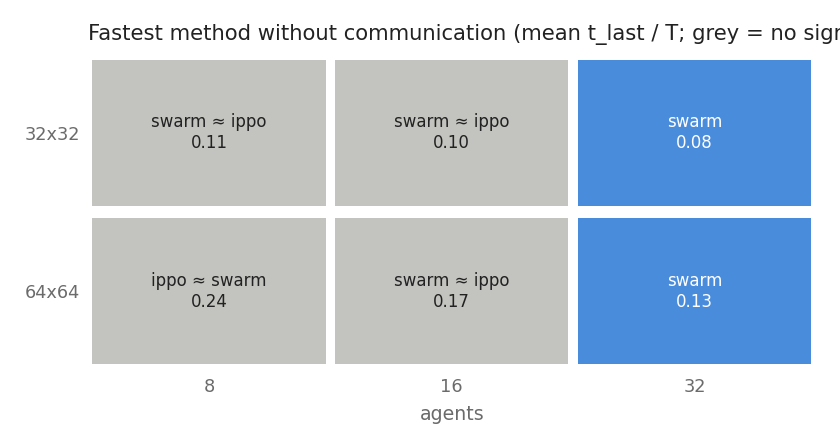 | 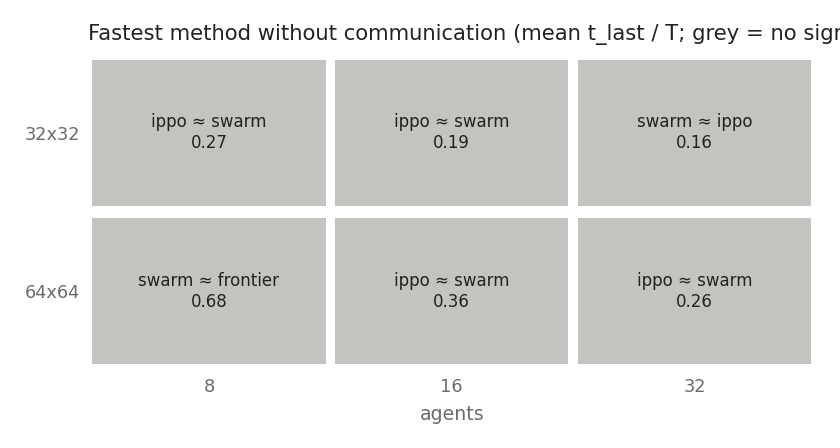 |  |

### 5. How far from optimal?

For the 64×64 episodes without failures I computed a lower bound on t_last for each episode
(`scripts/lower_bound.py`): the larger of a travel bound (the last target has to be reached from the
base) and an area bound (an agent can add at most 5 searched cells per step).

| method | t_last / T (mean) | success | median steps, solved episodes | median t_last / bound |
|---|---|---|---|---|
| frontier + maps, r_c = 5 | 0.233 | 0.982 | 81 | 1.51 |
| frontier + allocation, global | 0.187 | 1.000 | 78 | 1.54 |
| swarm rule | 0.359 | 0.855 | 82 | 1.65 |
| IPPO | 0.319 | 0.900 | 80 | 1.67 |
| frontier | 0.537 | 0.745 | 166 | 3.43 |
| Lévy walk | 0.641 | 0.610 | 171 | 4.02 |
| random walk | 0.867 | 0.235 | 197 | 6.60 |

The mean 0.36 of the swarm rule on 64×64 looks bad, but 40% of it comes from the 14.5% unsolved
episodes. They are concentrated on density 0.3 (success 0.57) and with few agents, where a purely
local rule cannot get out of dead-end pockets. When it does succeed it is within 1.65× of the bound,
close to frontier with communication. (Medians over solved episodes are biased in favour of methods
that fail on the hard ones.)

### Coverage

Exploration quality without early stopping (32×32, full horizon):

| 16 agents, no failures | 16 agents, 50% failures |
|---|---|
| 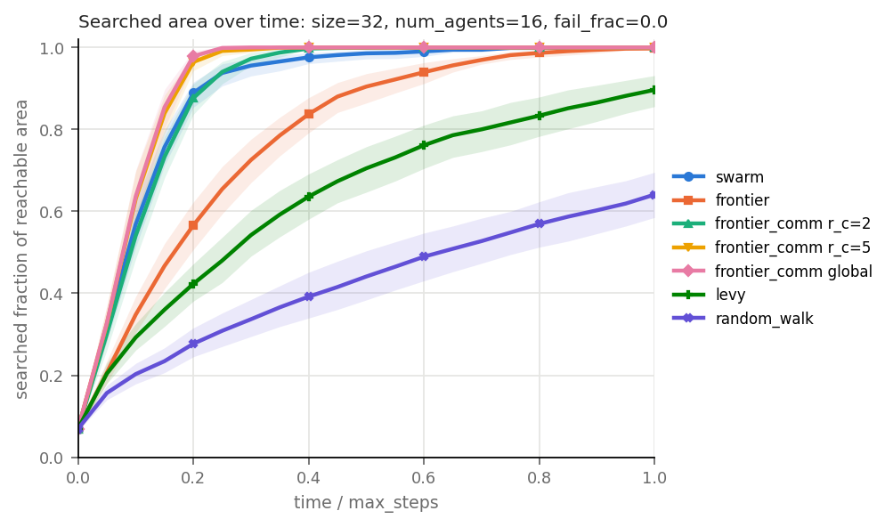 | 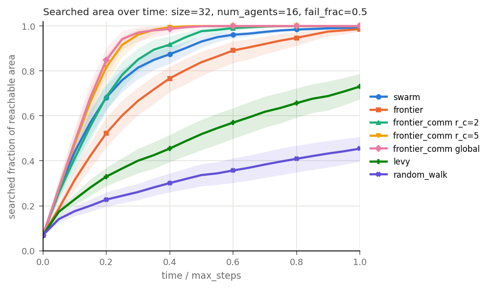 |

Coverage and search success are not the same thing: with a target prior the swarm rule covers less
area but finds the targets faster.

Full tables: `results/analysis_full.md`, `results/analysis_prior.md`, `results/analysis_maze.md`,
`results/analysis_warehouse.md`.

## GIF gallery

**The same episode for every method** (32×32, 16 agents, 3 targets, 25% failures, seed 4):

| random walk | Lévy walk | frontier |
|---|---|---|
|  | 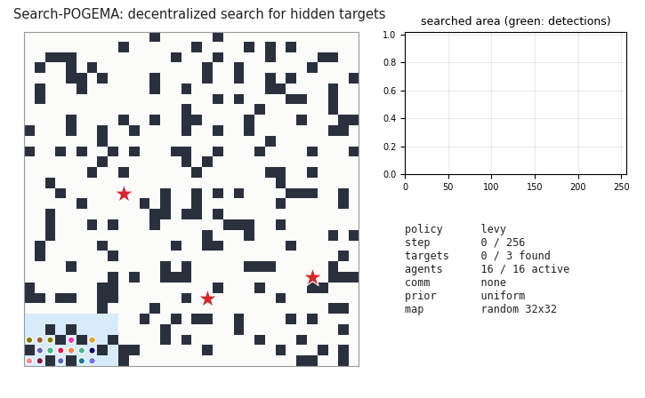 | 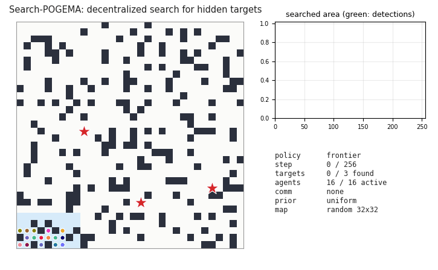 |
| **frontier + maps, r_c = 5** | **frontier + allocation, global** | **swarm rule** |
| 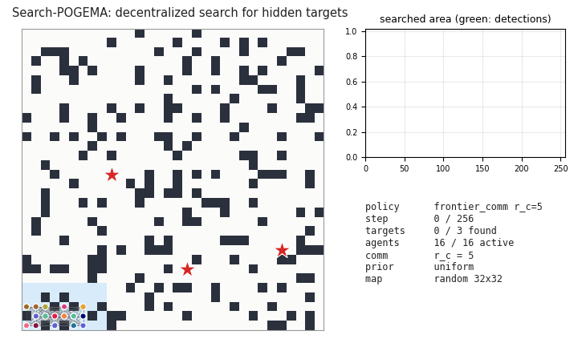 | 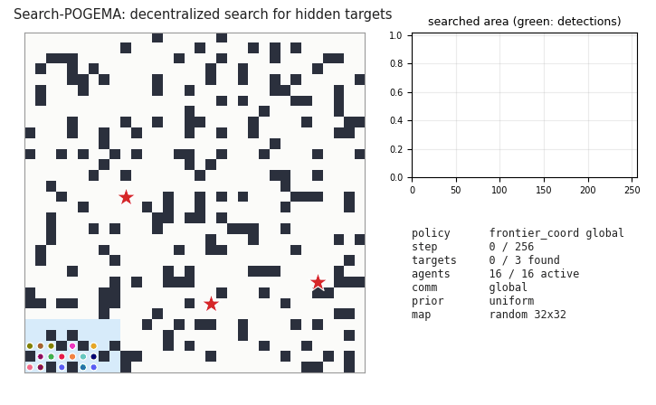 |  |
| **IPPO** | | |
|  | | |

**Target prior** (orange contours), 12 agents:

| swarm rule | frontier | IPPO |
|---|---|---|
|  | 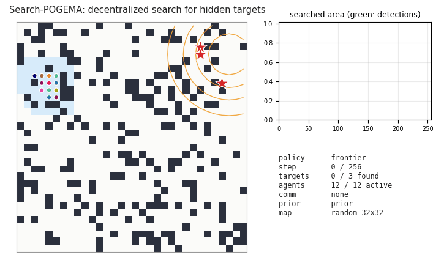 |  |

**Maze and warehouse**:

| maze: swarm rule | maze: frontier + maps | warehouse: swarm rule | warehouse: IPPO |
|---|---|---|---|
|  | 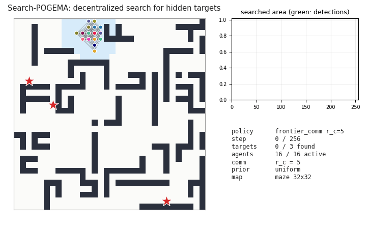 |  | 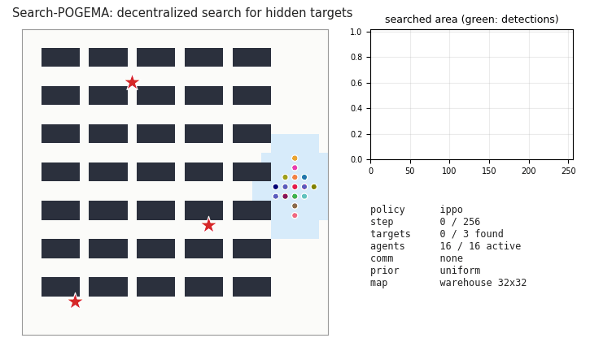 |

**64×64, 32 agents** (IPPO was trained only up to 32×32):

| swarm rule | IPPO | frontier + allocation, global |
|---|---|---|
|  |  | 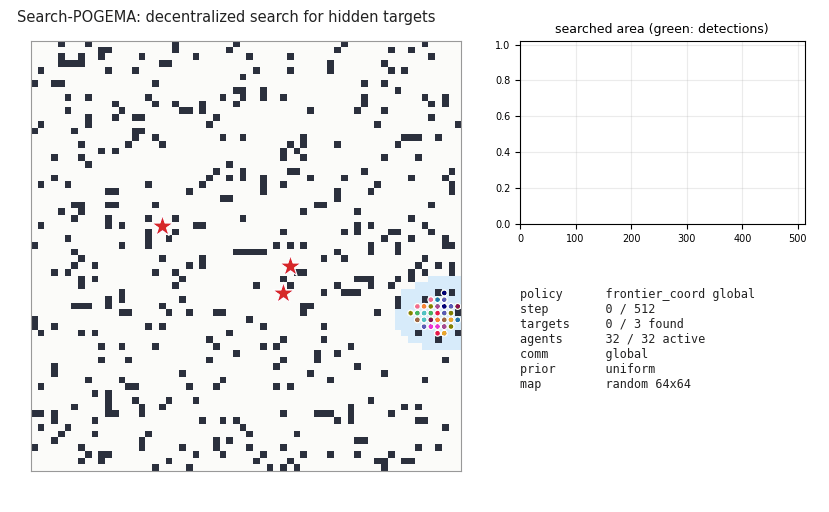 |

**Half of the agents fail**:

| swarm rule | frontier + maps, r_c = 5 |
|---|---|
|  | 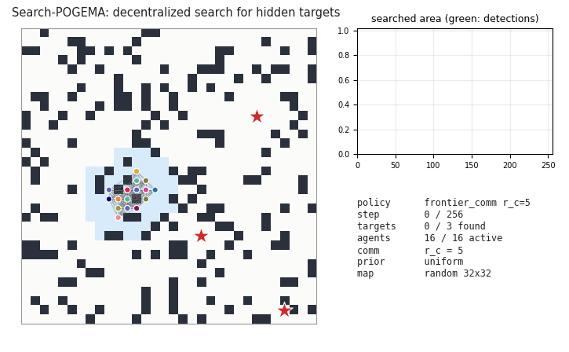 |

All GIFs: `python scripts/make_all_gifs.py`.

## Things that went wrong and what I learned

* **Failure timing biased robustness.** At first the failure time was drawn from the first half of
  the episode limit. Fast methods finished before most failures happened (the swarm rule lost 1.7 of 8
  agents on average, the random walk 6.6), so robustness numbers were not comparable. Now failures
  happen during the first 0.5·size steps for every method. The old results are kept in
  `results/discarded/`.
* **Centroid attraction trap** in the swarm rule (see Methods).
* **Coverage curves with early stopping are misleading** (they freeze when all targets are found), so
  coverage is measured in separate full-horizon runs.
* **A winner map by means only is misleading.** The first version said "IPPO wins on all 64×64 maps";
  with a paired test most cells are ties.
* **Tuning on few seeds overfits.** On 4 tuning seeds goal allocation looked much better on 64×64 with
  8 agents (0.46 vs 0.65 of T). On the evaluation seeds it was worse (0.305 vs 0.259).
* POGEMA details that matter: `on_target='finish'` removes agents, `reset(seed)` keeps the map,
  pydantic validators need `size` before `agents_xy`.

## Limitations and next steps

* IPPO: 2.5M agent-steps and maps up to 32×32 only. Longer training, a 64×64 phase, a recurrent policy
  or MAPPO may change the ranking.
* Swarm weights were tuned on 32 episodes per setting; the allocation scheme is a simple priority one,
  an auction or centralized assignment could be stronger.
* No line of sight; agents know their global position; a failed robot looks like an active one.
* 10 seeds per cell (seeds 10–19 can be added with `--max-seed 20`, about 2 hours).
* Next: a hybrid where the swarm rule or frontier picks subgoals and a pretrained POGEMA policy
  (Follower or MAPF-GPT) moves the agents; a swarm rule with short local planning to escape dead ends;
  learned communication under a message budget.

## Reproduce

```bash
python3.11 -m venv .venv && source .venv/bin/activate
pip install -r requirements.txt
pip install --no-deps pogema-toolbox==0.1.1   # only its map generators are used
pytest -q                                     # 50 tests

# experiments (resumable: rerun the same command until "pending after this run: 0")
python scripts/run_eval.py configs/full_grid.yaml --max-seed 10 --budget-min 9
python scripts/run_eval.py configs/slice_prior.yaml
python scripts/run_eval.py configs/slice_maps.yaml
python scripts/analyze_full.py results/full_grid.csv --tag full
python scripts/analyze_full.py results/slice_prior.csv --tag prior
python scripts/analyze_full.py results/slice_maps.csv --tag maze --where "map_type == 'maze'"

# IPPO (resumable)
python scripts/train_ppo.py --name ippo_v1 --budget-min 9
python scripts/plot_learning_curve.py

# tuning on tuning seeds
python scripts/tune.py
python scripts/tune_coord.py

python scripts/make_all_gifs.py
cd report && pdflatex report.tex
```

Python 3.11 is required: pogema 1.3.1 pins numpy ≤ 1.23.5 and pydantic ≤ 1.9.1. Everything runs on
CPU; the full grid takes about 2 hours on two cores for 10 seeds.

## Repository layout

```
pogema_search/
  env.py          search task on top of POGEMA (SearchConfig, SearchPogema, AgentObs)
  maps.py         random / maze / warehouse maps
  metrics.py      episode metrics, bootstrap CIs
  experiment.py   yaml spec -> episodes -> resumable CSV
  render.py       GIF frames
  policies/       random_walk, levy, frontier (+ comm, + allocation), swarm, ippo
  rl/             observation encoder, actor-critic, IPPO trainer
configs/          experiment specs
scripts/          run_eval, analyze_full, make_plots, make_all_gifs, train_ppo, tune, lower_bound, ...
results/          raw CSVs and markdown tables
figures/          plots and GIFs
runs/ippo_v1/     trained model, checkpoints used for model selection, learning curve
report/           report.tex, report.pdf
tests/            pytest
```

## References

* A. Skrynnik et al. POGEMA: A Benchmark Platform for Cooperative Multi-Agent Pathfinding. ICLR 2025.
* B. Yamauchi. A frontier-based approach for autonomous exploration. CIRA 1997; Frontier-based
  exploration using multiple robots. Agents 1998.
* W. Burgard et al. Coordinated multi-robot exploration. IEEE T-RO 2005.
* G. M. Viswanathan et al. Optimizing the success of random searches. Nature 1999.
* C. Schroeder de Witt et al. Is independent learning all you need in the StarCraft multi-agent
  challenge? 2020.

## License

MIT
