# Search-POGEMA

**Децентрализованный поиск скрытых целей группой агентов на базе [POGEMA](https://github.com/Cognitive-AI-Systems/pogema).**
Роевые правила против фронтирного исследования и обученной политики IPPO при частичной наблюдаемости,
ограниченной связи и выходе агентов из строя.

[English version](README.md) · [Отчёт (PDF, 5 страниц, англ.)](report/report.pdf)

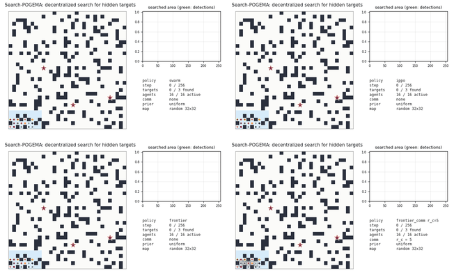

*Один и тот же эпизод для четырёх методов: карта 32×32, 16 агентов стартуют с одной базы, 3 скрытые цели
(красная звезда — не найдена, зелёная — найдена), 25% агентов выходят из строя во время поиска (серый ×).
Голубое — обысканная зона, чем темнее, тем позже. Это один эпизод для иллюстрации, статистика ниже.*

---

## Содержание

1. [Зачем это нужно](#зачем-это-нужно)
2. [Постановка задачи](#постановка-задачи)
3. [Метрики](#метрики)
4. [Методы](#методы)
5. [Эксперименты](#эксперименты)
6. [Результаты](#результаты)
7. [Галерея анимаций](#галерея-анимаций)
8. [Что пошло не так и чему я научился](#что-пошло-не-так-и-чему-я-научился)
9. [Ограничения и что дальше](#ограничения-и-что-дальше)
10. [Как воспроизвести](#как-воспроизвести)
11. [Структура репозитория](#структура-репозитория)

---

## Зачем это нужно

POGEMA — быстрый бенчмарк для децентрализованного многоагентного планирования путей (MAPF). Там каждый
агент знает свою цель и должен дойти до неё без столкновений, видя только небольшое окно вокруг себя.
Во многих реальных задачах группы роботов цель **неизвестна**: поисково-спасательные операции, осмотр
территории, поиск потерянных объектов. Группе нужно быстро рассредоточиться, покрыть область, не
обыскивать одно место дважды и продолжать работу, когда связь плохая, а часть роботов сломалась.

Вопрос проекта:

> Как локальные роевые правила соотносятся с классическим фронтирным исследованием и обученной
> MARL-стратегией при поиске скрытых целей в частично наблюдаемой среде с ограниченной связью и потерей агентов?

Я сохранил всё, что POGEMA делает хорошо (карты, движение, столкновения, эгоцентричное наблюдение,
скорость), и добавил недостающие части задачи поиска.

## Постановка задачи

| элемент | как устроено |
|---|---|
| карты | случайные карты POGEMA (плотность препятствий 0–0,3), лабиринты и склады из `pogema-toolbox` |
| движение | динамика POGEMA: 5 действий (стоять, вверх, вниз, влево, вправо), столкновения `priority` |
| агенты | N агентов стартуют кучей вокруг случайной базы (развёртывание из одной точки) |
| цели | K скрытых целей в той же связной области, что и агенты, не видны в момент старта; равномерно или из гауссова распределения, центр и ширину которого агенты знают |
| датчики | окно POGEMA радиуса 3; цель найдена, когда активный агент оказался на расстоянии Чебышёва ≤ 2 |
| память | каждый агент помнит увиденные клетки, известные препятствия, обысканные клетки и свои посещения |
| связь | агенты на евклидовом расстоянии ≤ r_c объединяют память, один «прыжок» за шаг; r_c = 0 — связи нет, r_c = ∞ — глобальная |
| отказы | доля p агентов в случайный момент `~U[1, 0,5·size]` перестаёт двигаться, видеть и общаться; сломанный робот продолжает занимать клетку |
| конец эпизода | все цели найдены или прошло `T = 8·size` шагов |

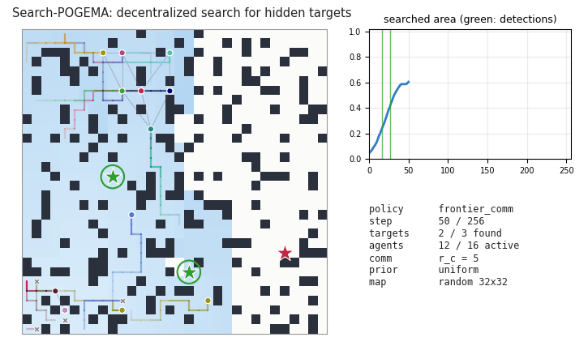

**Как это встроено в POGEMA** (`pogema_search/env.py`):
- **Режим POGEMA:** используется `PogemaCoopFinish` с `on_target='nothing'`. В режиме по умолчанию `'finish'` агент исчезает, дойдя до своей цели POGEMA, а в задаче поиска это бессмысленно.
- **Отказ агента** реализован через `grid.is_active`, поэтому сломанного агента перестаёт двигать сама POGEMA.
- **Новая карта на каждый эпизод:** `reset(seed=...)` в POGEMA карту не меняет, поэтому на каждый эпизод создаётся новый `GridConfig`.

## Метрики

* **success** — найдены ли все цели за T шагов;
* **t_first, t_last** — время до первого и до последнего обнаружения, в долях T; если цель не найдена,
  эпизод засчитывается как T;
* **кривая покрытия** (доля обысканной достижимой площади во времени) и площадь под ней (AUC);
* **доля повторных посещений** = 1 − число разных посещённых клеток / число агенто-шагов;
* **объём связи** — число сообщений и переданных клеток;
* **робастность** = метрика(p) / метрика(0) на тех же сидах.

Все числа — средние с 95% доверительным интервалом (percentile bootstrap). Все методы запускаются на
**одних и тех же сидах**: у них одинаковые карты, старты, цели и моменты отказов (парное сравнение).

## Методы

| метод | идея | что использует |
|---|---|---|
| `random_walk` | случайный ход в свободную соседнюю клетку | локальное окно |
| `levy` | блуждание Леви: прямые «полёты» длины L, P(L) ∝ L^−μ, μ = 2 | локальное окно |
| `frontier` | ближайший фронтир (Yamauchi): поиск в ширину по своей карте до ближайшей известной свободной клетки, которая не обыскана или граничит с неизвестным | своя карта |
| `frontier_comm` | то же, карты объединяются с соседями в радиусе r_c | своя + полученные карты |
| `frontier_coord` | + обмен целями: агенты сообщают свою цель, фронтир рядом с целью соседа с более высоким приоритетом штрафуется (децентрализованный вариант Burgard et al., 2005) | карты + цели соседей |
| `swarm` | локальное роевое правило, см. ниже | своя память, окно, априорное распределение |
| `ippo` | одна общая CNN actor-critic, обученная независимым PPO | своя память, окно, априорное распределение |

**Роевое правило** (`policies/swarm.py`). На каждом шаге агент выбирает свободную соседнюю клетку
с наибольшей оценкой:

```
оценка = w_gain · новые клетки в зоне обнаружения
       − w_visit · сколько раз я тут был
       − w_rep · Σ max(0, 1 − d / R) по видимым агентам        (рассредоточение)
       + w_pull · cos(ход, направление к необысканной априорной массе)  (сильнее, если рядом ничего нового)
       + w_mom · [тот же ход, что раньше] + небольшой шум
```

Направление притяжения: Σ p(c)·e^(−d/λ)·(c − x)/d² по необысканным клеткам. Первая версия тянула к
центру масс необысканной области и работала очень плохо. Центр масс часто оказывается внутри уже
обысканной «дыры», и агент кружит вокруг него: один агент покрывал 16% карты вместо 74%.

**IPPO** (`rl/`).
- **Наблюдение агента:**
  - срез 15×15 его собственной памяти, 7 каналов: известные препятствия, неизвестное, обысканное, видимые агенты, посещения, априорное распределение, «за краем карты»;
  - вся карта, сжатая до 8×8, поэтому одна и та же сеть работает на картах 16, 32 и 64;
  - доля прошедшего времени t/T и доля найденных целей.
- **Маска:** недопустимые ходы запрещены.
- **Награда:** +1 за найденную цель и +0,02 за клетку, которую агент обыскал первым в группе, с весом априорного распределения.
- **Curriculum:** 16×16 → 32×32 со случайными плотностью, числом целей, распределением, отказами и r_c ∈ {0, 5}.
- **Объём обучения:** 2,47 млн агенто-шагов, около 45 минут на двух ядрах CPU.

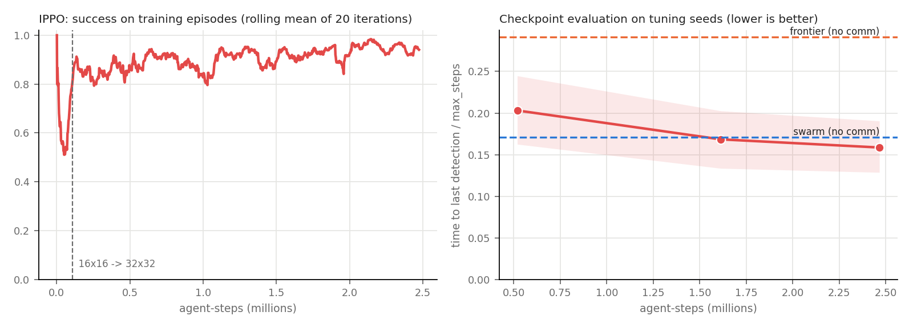

**Сиды разделены на три непересекающихся диапазона:** обучение 10⁶+, настройка 10⁴+, оценка 0–19. Только на сидах для настройки подбирались:
- веса роевого правила и показатель μ у Lévy;
- параметры распределения целей у frontier с координацией;
- чекпоинт IPPO и способ выбора действия: сэмплирование, потому что жадный argmax застревает в циклах.

## Эксперименты

* **Полная сетка**, равномерные цели, случайные карты: размер {16, 32, 64} × плотность {0; 0,1; 0,2; 0,3} ×
  агенты {4, 8, 16, 32, 64} × цели {1, 3} × доля отказов {0; 0,25; 0,5}. Радиус связи r_c ∈ {2, 5, ∞}
  для вариантов frontier со связью и {0, ∞} для IPPO. По 10 сидов на ячейку, **43 200 эпизодов**.
* **Срез с априорным распределением:** размеры 32/64, плотность 0,1/0,2, 8/16/32 агента, p ∈ {0; 0,5}.
* **Срез с картами:** лабиринты и склады, размеры 32/64, 8/16/32 агента, p ∈ {0; 0,5}.

## Результаты

### Общая таблица

Полная сетка, усреднение по всем 360 конфигурациям (по 3 600 эпизодов на метод):

| метод | успех | t_last / T | повторные посещения | сообщений за эпизод |
|---|---|---|---|---|
| случайное блуждание | 0,461 [0,444; 0,477] | 0,716 [0,704; 0,727] | 0,825 | 0 |
| Lévy walk | 0,740 [0,725; 0,754] | 0,501 [0,489; 0,514] | 0,692 | 0 |
| frontier | 0,868 [0,857; 0,878] | 0,409 [0,399; 0,420] | 0,675 | 0 |
| **роевое правило** | 0,900 [0,890; 0,909] | **0,259** [0,249; 0,269] | 0,463 | 0 |
| **IPPO** | 0,914 [0,905; 0,922] | **0,259** [0,250; 0,269] | 0,470 | 0 |
| frontier + карты, r_c = 2 | 0,951 [0,944; 0,958] | 0,242 [0,234; 0,250] | 0,481 | 1 619 |
| frontier + карты, r_c = 5 | 0,975 [0,969; 0,980] | 0,194 [0,187; 0,201] | 0,430 | 6 026 |
| frontier + карты, глобально | 0,985 [0,981; 0,989] | 0,178 [0,172; 0,184] | 0,412 | 25 483 |
| frontier + распределение целей, r_c = 5 | 0,976 [0,972; 0,981] | 0,200 [0,194; 0,207] | 0,456 | 7 459 |
| frontier + распределение целей, глобально | 0,989 [0,986; 0,992] | **0,173** [0,168; 0,178] | 0,424 | 28 753 |
| IPPO с глобальными картами (без переобучения) | 0,934 [0,925; 0,942] | 0,223 [0,214; 0,232] | 0,428 | 29 011 |

### 1. Без связи роевое правило и IPPO вровень и сильно опережают frontier

Оба метода в 1,5–2,2 раза быстрее фронтирного исследования без связи, в зависимости от размера карты.
Frontier без общей карты отправляет соседних агентов к одним и тем же ближайшим фронтирам: доля повторных
посещений 0,68 против 0,46. По ячейкам, с парным тестом:

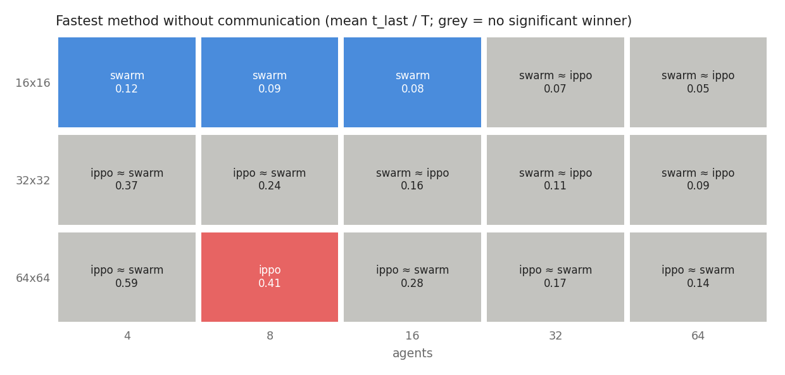

*Серые ячейки: 95% доверительный интервал парной разницы двух лучших методов включает ноль, то есть
победителя нет.*

Роевое правило значимо лучше на картах 16×16 при 4–16 агентах, IPPO — только на 64×64 при 8 агентах,
в остальных ячейках ничья. С ростом карты IPPO становится относительно сильнее. t_last/T, роевое правило против IPPO:

| карта | роевое правило | IPPO |
|---|---|---|
| 16×16 | 0,083 | 0,105 |
| 32×32 | 0,195 | 0,198 |
| 64×64 | 0,359 | 0,319 |

При этом карт 64×64 IPPO при обучении не видел.

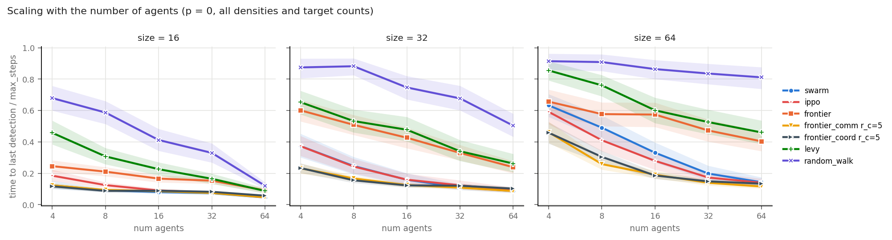

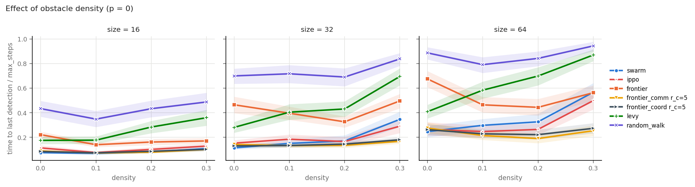

На пустой карте 64×64 frontier без связи работает даже хуже, чем на карте с препятствиями (0,68 против
0,44 от T). Стены не разводят агентов, стартующих с одной базы, и они снова и снова выбирают одни и те
же фронтиры.

### 2. Связь — самый сильный фактор

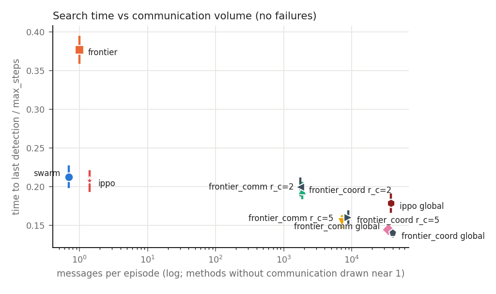

* **r_c = 5 даёт почти весь эффект глобального обмена картами** (0,154 против 0,144 от T без отказов) примерно при 21% сообщений.
* **r_c = 2 лишь немного быстрее роевого правила без связи** (0,195 против 0,213), хотя отправляет около 1 900 сообщений за эпизод.
* **IPPO выигрывает от общих карт без переобучения** (0,207 → 0,178): на входе у него собственная память, а её объединяет среда. Выигрыш меньше, чем у frontier, потому что планировщик frontier использует карту явно.
* **Распределение целей — не бесплатный выигрыш.**
  - При глобальной связи это самый быстрый метод: парная разница с frontier + карты −0,005 [−0,008; −0,001], в основном за счёт 64×64 (−0,016). На 16×16 координация слегка мешает.
  - При r_c = 5 в целом чуть хуже (+0,006 [+0,003; +0,010]). Агент видит заявки только ближайших соседей, штраф уводит его к дальним фронтирам, а общей картины у него нет.

### 3. Потеря агентов

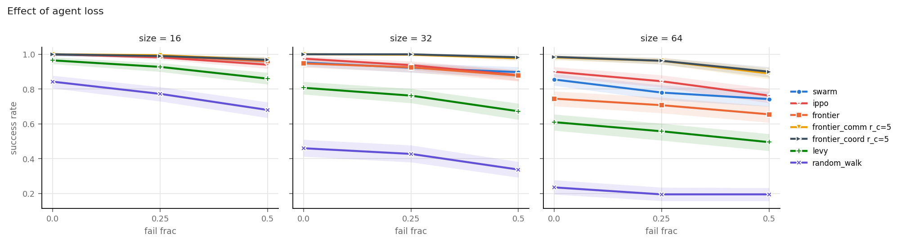

Потеря половины агентов замедляет поиск:

| метод | во сколько раз дольше |
|---|---|
| роевое правило | 1,44 |
| IPPO | 1,54 |
| frontier с r_c = 5 | 1,60 |

Относительные числа выгодны медленным методам: случайное блуждание теряет всего ×1,12, потому что и так почти упирается в лимит шагов. Поэтому важнее абсолютный успех. На 64×64 при отказе половины агентов он равен 0,74 у роевого правила, 0,76 у IPPO и 0,89 у frontier с r_c = 5. На больших картах больше всего помогает избыточность за счёт общих карт.

### 4. Априорное распределение, лабиринты, склады

t_last / T, среднее [95% ДИ]:

| метод | гауссово распределение | лабиринт | склад |
|---|---|---|---|
| frontier | 0,507 [0,467; 0,548] | 0,635 [0,581; 0,687] | 0,625 [0,566; 0,681] |
| роевое правило | **0,164** [0,148; 0,181] | 0,470 [0,406; 0,532] | 0,275 [0,241; 0,313] |
| IPPO | 0,174 [0,158; 0,191] | 0,421 [0,367; 0,477] | 0,302 [0,265; 0,342] |
| frontier + карты, r_c = 5 | 0,227 [0,202; 0,253] | 0,247 [0,219; 0,278] | 0,223 [0,197; 0,252] |
| frontier + карты, глобально | 0,178 [0,162; 0,195] | 0,218 [0,197; 0,242] | 0,187 [0,169; 0,205] |
| frontier + распределение целей, глобально | 0,168 [0,154; 0,183] | **0,216** [0,198; 0,237] | **0,183** [0,168; 0,198] |
| IPPO с глобальными картами | **0,143** [0,128; 0,159] | 0,390 [0,337; 0,447] | 0,220 [0,190; 0,252] |

* **При известном распределении целей роевое правило без единого сообщения (0,164) не уступает
  frontier с глобальным обменом картами (0,178).** Frontier распределение игнорирует, а слабое
  притяжение роевого правила собирает агентов там, где цели вероятнее.
* **В лабиринтах всё наоборот.** Без общей карты агенты раз за разом заходят в одни и те же тупики, и
  frontier с обменом карт в 1,7–1,9 раза быстрее любого метода без связи.

| распределение | лабиринт | склад |
|---|---|---|
| 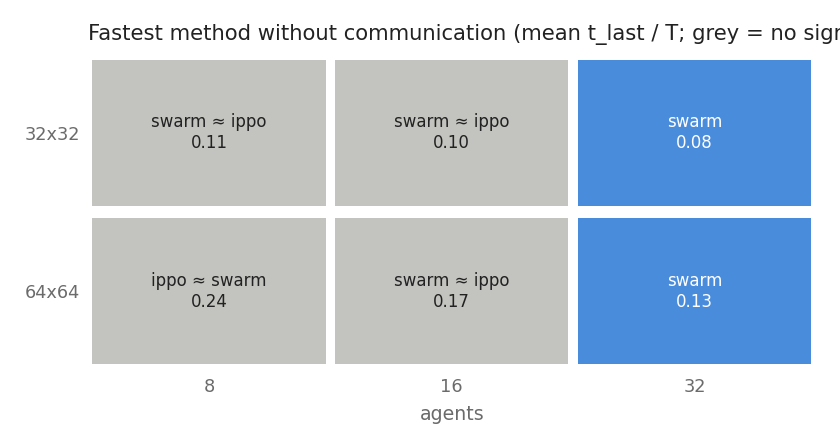 | 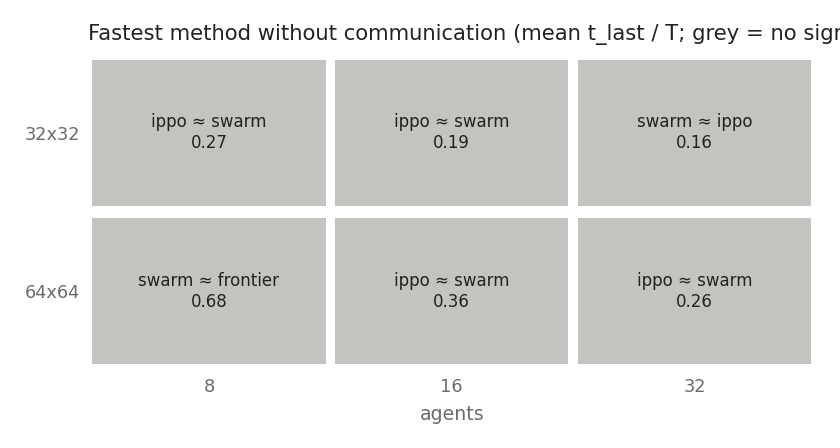 |  |

### 5. Насколько далеко от оптимума

Для эпизодов 64×64 без отказов я посчитал нижнюю границу t_last для каждого эпизода
(`scripts/lower_bound.py`). Это большее из двух ограничений:
- **дорога:** до последней цели нужно доехать от базы;
- **площадь:** один агент за шаг может обыскать не больше 5 новых клеток.

| метод | t_last / T (среднее) | успех | медиана шагов в успешных эпизодах | медиана t_last / граница |
|---|---|---|---|---|
| frontier + карты, r_c = 5 | 0,233 | 0,982 | 81 | 1,51 |
| frontier + распределение целей, глобально | 0,187 | 1,000 | 78 | 1,54 |
| роевое правило | 0,359 | 0,855 | 82 | 1,65 |
| IPPO | 0,319 | 0,900 | 80 | 1,67 |
| frontier | 0,537 | 0,745 | 166 | 3,43 |
| Lévy walk | 0,641 | 0,610 | 171 | 4,02 |
| случайное блуждание | 0,867 | 0,235 | 197 | 6,60 |

Среднее 0,36 у роевого правила на 64×64 выглядит плохо, но 40% этой величины дают 14,5% нерешённых
эпизодов. Они сосредоточены при плотности 0,3 (успех 0,57) и при малом числе агентов. Там чисто
локальное правило не умеет выбраться из тупиковых карманов. В успешных эпизодах роевое правило всего в
1,65 раза дольше нижней границы, почти как frontier со связью. Медианы по успешным эпизодам
смещены в пользу методов, которые проваливаются на трудных эпизодах.

### Покрытие

Качество исследования без досрочной остановки (32×32, полный лимит шагов):

| 16 агентов, без отказов | 16 агентов, 50% отказов |
|---|---|
| 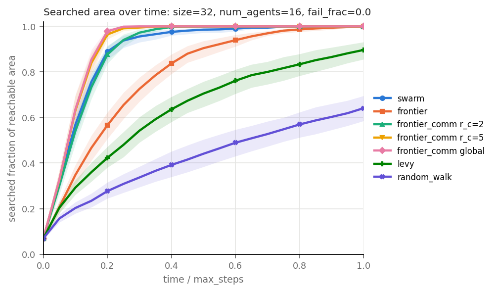 | 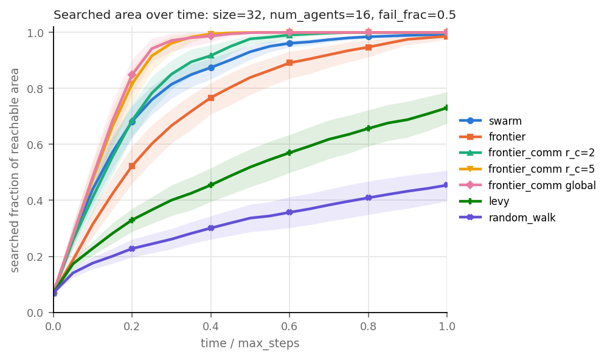 |

Покрытие и успех поиска — разные вещи. При известном распределении роевое правило покрывает меньше
площади, но находит цели быстрее.

Полные таблицы: `results/analysis_full.md`, `results/analysis_prior.md`, `results/analysis_maze.md`,
`results/analysis_warehouse.md`.

## Галерея анимаций

**Один и тот же эпизод для всех методов** (32×32, 16 агентов, 3 цели, 25% отказов, сид 4). На этом
эпизоде роевое правило и IPPO нашли все цели за 29 шагов, а в среднем на такой конфигурации у них
около 50–60. Эпизод удачный, он показывает поведение, а не статистику.

| случайное блуждание | Lévy walk | frontier |
|---|---|---|
|  | 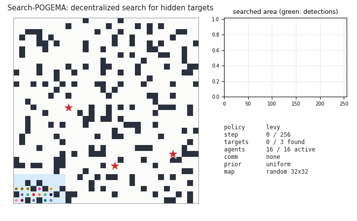 | 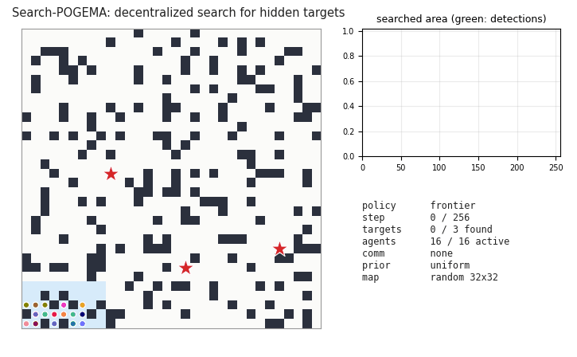 |
| **frontier + карты, r_c = 5** | **frontier + распределение целей, глобально** | **роевое правило** |
| 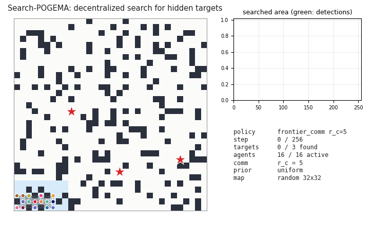 | 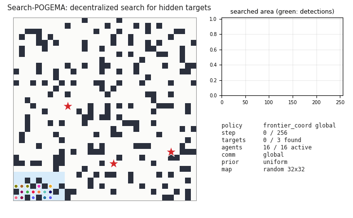 |  |
| **IPPO** | | |
|  | | |

**Цели из априорного распределения** (оранжевые контуры), 12 агентов:

| роевое правило | frontier | IPPO |
|---|---|---|
|  | 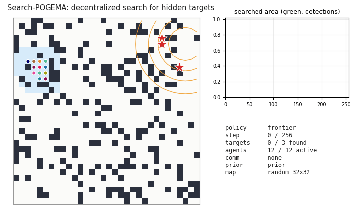 |  |

**Лабиринт и склад**:

| лабиринт: роевое правило | лабиринт: frontier + карты | склад: роевое правило | склад: IPPO |
|---|---|---|---|
|  | 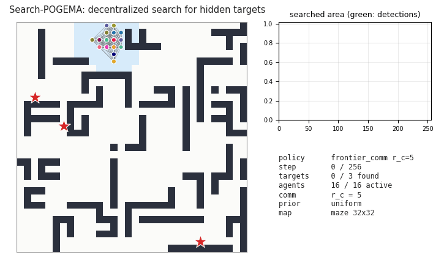 |  | 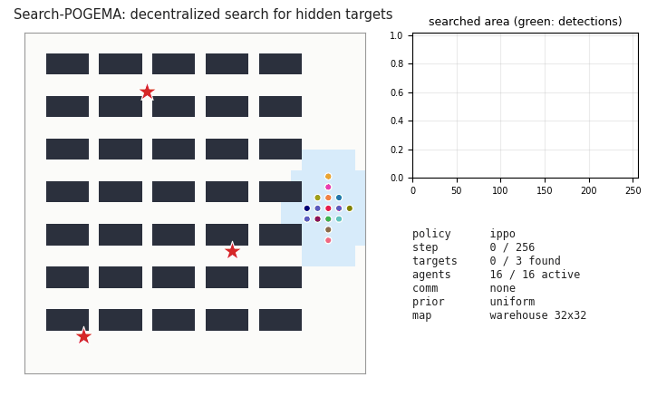 |

**64×64, 32 агента** (IPPO обучался только до 32×32):

| роевое правило | IPPO | frontier + распределение целей, глобально |
|---|---|---|
|  |  | 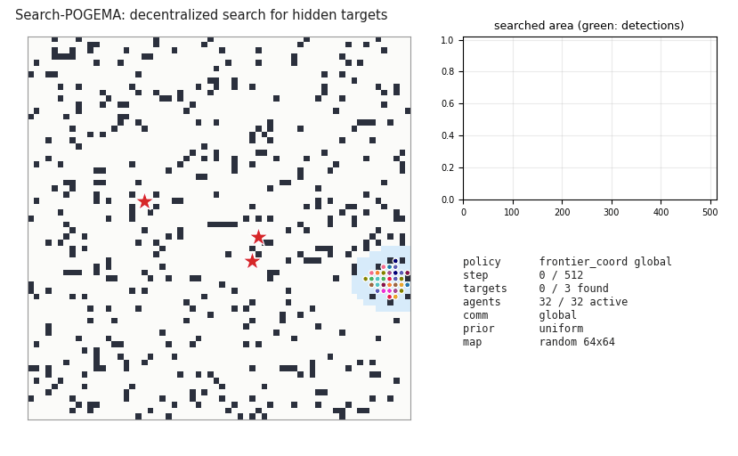 |

**Половина агентов выходит из строя**:

| роевое правило | frontier + карты, r_c = 5 |
|---|---|
|  | 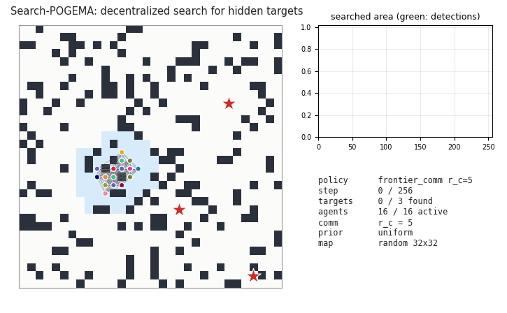 |

Все анимации: `python scripts/make_all_gifs.py`.

## Что пошло не так и чему я научился

* **Момент отказа искажал робастность.** Сначала время отказа выбиралось из первой половины лимита
  шагов, и быстрые методы заканчивали поиск до того, как большинство отказов случалось. Роевое правило
  в среднем теряло 1,7 агента из 8, случайное блуждание 6,6, сравнивать их было нельзя. Теперь отказы
  происходят в первые 0,5·size шагов у всех методов. Старые результаты лежат в `results/discarded/`.
* **Ловушка центра масс** в роевом правиле (см. «Методы»).
* **Кривые покрытия с досрочной остановкой вводят в заблуждение:** они замирают, когда все цели найдены.
  Поэтому покрытие меряется в отдельных прогонах на полный лимит шагов.
* **Карта победителей по средним вводит в заблуждение.** Первая версия говорила «IPPO выигрывает на всех
  картах 64×64», а с парным тестом большинство ячеек оказались ничьими.
* **Настройка на малом числе сидов переобучается.** На 4 сидах для настройки распределение целей выглядело
  намного лучше на 64×64 с 8 агентами (0,46 против 0,65 от T). На оценочных сидах вышло хуже (0,305 против 0,259).
* **Важные мелочи POGEMA:** `on_target='finish'` удаляет агентов, `reset(seed)` не меняет карту,
  валидаторам pydantic нужен `size` раньше `agents_xy`.

## Ограничения и что дальше

* **IPPO обучен мало:** 2,5 млн шагов и карты только до 32×32. Более долгое обучение, фаза 64×64,
  рекуррентная политика или MAPPO могут поменять расстановку.
* **Настройка и координация упрощены.** Веса роевого правила подобраны на 32 эпизодах на настройку.
  Распределение целей — простая схема с приоритетами; аукцион или централизованное назначение могут быть сильнее.
* **Упрощения среды:** нет учёта прямой видимости, агенты знают свою глобальную позицию, сломанный робот выглядит как живой.
* **10 сидов на ячейку.** Сиды 10–19 добавляются флагом `--max-seed 20`, это около 2 часов.
* **Дальше:**
  - гибрид, где роевое правило или frontier выбирает подцели, а агентов двигает предобученная политика POGEMA (Follower или MAPF-GPT);
  - роевое правило с коротким локальным планированием, чтобы выбираться из тупиков;
  - обучаемый обмен сообщениями при ограниченном бюджете связи.

## Как воспроизвести

```bash
python3.11 -m venv .venv && source .venv/bin/activate
pip install -r requirements.txt
pip install --no-deps pogema-toolbox==0.1.1   # используются только генераторы карт
pytest -q                                     # 50 тестов

# эксперименты (прогон продолжается с места остановки: повторять, пока не будет "pending after this run: 0")
python scripts/run_eval.py configs/full_grid.yaml --max-seed 10 --budget-min 9
python scripts/run_eval.py configs/slice_prior.yaml
python scripts/run_eval.py configs/slice_maps.yaml
python scripts/analyze_full.py results/full_grid.csv --tag full
python scripts/analyze_full.py results/slice_prior.csv --tag prior
python scripts/analyze_full.py results/slice_maps.csv --tag maze --where "map_type == 'maze'"

# IPPO (тоже продолжается с чекпоинта)
python scripts/train_ppo.py --name ippo_v1 --budget-min 9
python scripts/plot_learning_curve.py

# подбор параметров на сидах для настройки
python scripts/tune.py
python scripts/tune_coord.py

python scripts/make_all_gifs.py
cd report && pdflatex report.tex
```

Нужен Python 3.11: pogema 1.3.1 фиксирует numpy ≤ 1.23.5 и pydantic ≤ 1.9.1. Всё считается на CPU,
полная сетка на 10 сидах занимает около 2 часов на двух ядрах.

## Структура репозитория

```
pogema_search/
  env.py          задача поиска поверх POGEMA (SearchConfig, SearchPogema, AgentObs)
  maps.py         случайные карты, лабиринты, склады
  metrics.py      метрики эпизода, bootstrap-интервалы
  experiment.py   yaml-спецификация -> эпизоды -> CSV с продолжением после остановки
  render.py       кадры для GIF
  policies/       random_walk, levy, frontier (+ связь, + распределение целей), swarm, ippo
  rl/             кодирование наблюдения, actor-critic, обучение IPPO
configs/          спецификации экспериментов
scripts/          run_eval, analyze_full, make_plots, make_all_gifs, train_ppo, tune, lower_bound, ...
results/          сырые CSV и таблицы в markdown
figures/          графики и GIF
runs/ippo_v1/     обученная модель, чекпоинты для выбора модели, кривая обучения
report/           report.tex, report.pdf
tests/            тесты pytest
```

## Литература

* A. Skrynnik et al. POGEMA: A Benchmark Platform for Cooperative Multi-Agent Pathfinding. ICLR 2025.
* B. Yamauchi. A frontier-based approach for autonomous exploration. CIRA 1997; Frontier-based
  exploration using multiple robots. Agents 1998.
* W. Burgard et al. Coordinated multi-robot exploration. IEEE T-RO 2005.
* G. M. Viswanathan et al. Optimizing the success of random searches. Nature 1999.
* C. Schroeder de Witt et al. Is independent learning all you need in the StarCraft multi-agent
  challenge? 2020.

## Лицензия

MIT
